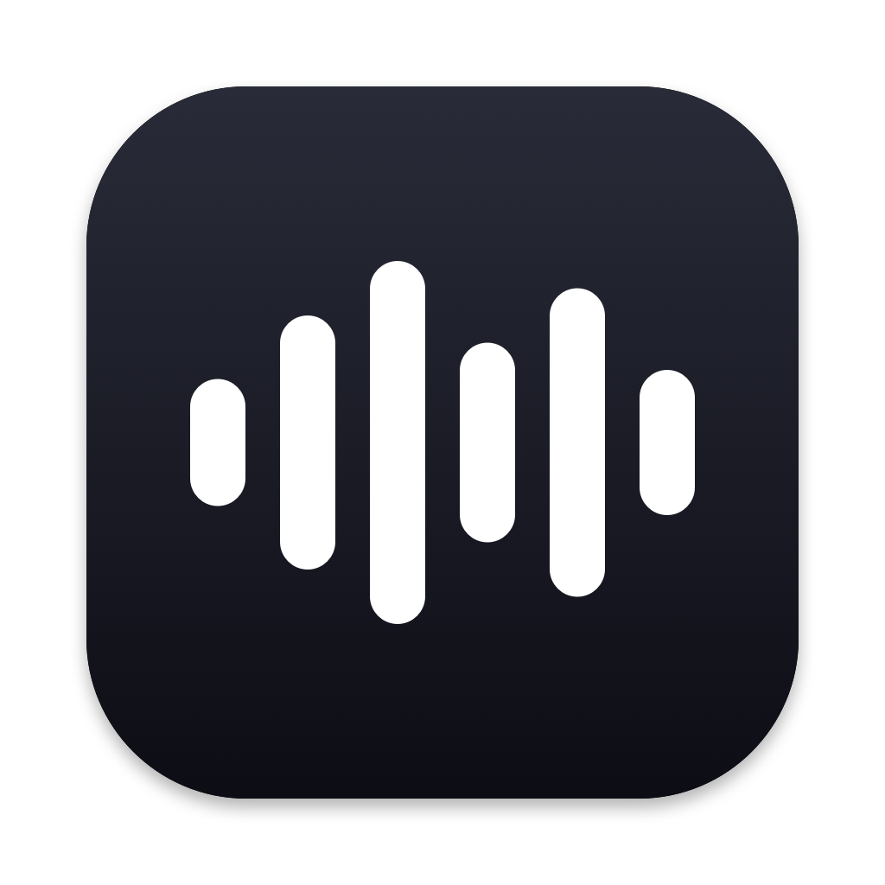

<p align="center"></p>

<h1 align="center">Waves</h1>

<p align="center">A native macOS menu bar audio visualizer, in the spirit of iOS.</p>

Waves shows live audio waves in your menu bar while anything is playing, and settles back into a speaker icon when it's quiet. Its menu doubles as the Sound menu, with volume and output devices, so you can hide Apple's and keep one icon.

- Styles: bars, mirrored, line, and dots
- Native template rendering that follows light/dark mode and the menu bar tint
- Fully idle when nothing is playing
- Exclude apps you don't want visualized
- Audio is analyzed on your Mac and never leaves it

## Install

```sh
brew install justamapping/tap/waves
```

Or download `Waves-<version>.zip` from [Releases](https://github.com/justamapping/waves-releases/releases/latest), unzip it, and move `Waves.app` to Applications.

Requires macOS 14.2 or later, Apple Silicon or Intel. On first launch, macOS asks for System Audio Recording permission, which Waves needs to see what's playing.
